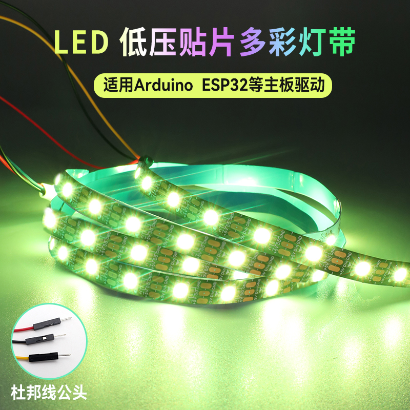
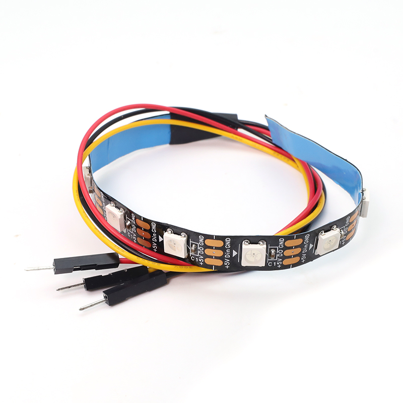

# SKU 22400154｜WS2812 RGB 灯带（10 灯，30 cm，黑色板）

## 产品图片






## 产品概述

本产品为 **WS2812 单线可编程 RGB 灯带**，共有 **10 颗可独立寻址灯珠**，长度约 **30 cm**，采用黑色柔性线路板。控制器只需一根数据线即可按顺序发送每颗灯珠的 RGB 数据，适用于灯效展示、状态提示、模型装饰和交互项目。

> **SKU 区分：**本 SKU 为 10 灯、30 cm、黑色板版本。测试程序已经按本 SKU 的灯珠数量和数据引脚单独配置，不需要再删除另一条灯带的代码。

## 已确认规格

| 项目 | 资料 |
|---|---|
| SKU | 22400154 |
| 产品类型 | WS2812 可编程 RGB 灯带 |
| 灯珠数量 | 10 颗 |
| 灯带长度 | 约 30 cm |
| 线路板颜色 | 黑色 |
| 连接线 | 红、黄、黑三线，杜邦公头 |
| 额定供电 | DC 5 V；通电前仍应核对实物丝印和批次标识 |
| 控制方式 | 单线数字信号，灯珠可独立寻址 |
| 代码像素格式 | `NEO_GRB`，RGB 三通道 |
| 代码数据时序 | `NEO_KHZ800` |
| 本 SKU 测试引脚 | ESP32 GPIO 12 |
| 环保属性 | 环保版（依据用户提供的 SKU 清单） |

额定电流、板宽、防水等级、工作温度和精确线序在现有源资料中没有唯一明确值，因此本文件不作无依据承诺。

## 工作原理

WS2812 灯珠内部集成控制电路。控制器从灯带的 **DIN 输入端**发送一串颜色数据，第一颗灯珠保留属于自己的数据，再把后续数据转发给下一颗，因此每颗灯珠都能显示不同颜色。灯珠数量必须与程序中的 `LED_COUNT` 一致；数量设置过小会导致后端灯珠不更新，设置过大则会发送多余数据。

## 接线说明

| 灯带端 | ESP32 / 电源端 | 说明 |
|---|---|---|
| 5 V / 电源正极 | 稳定的 5 V 电源 | 不要接反 |
| GND / 电源负极 | 电源 GND 与 ESP32 GND | **电源与控制器必须共地** |
| DIN / 数据输入 | ESP32 GPIO 12 | 从带有 DIN 标识或箭头起点的一端输入 |

原始清单显示红、黄、黑三线。建议将红色视为电源正极、黑色视为 GND、黄色视为数据线，但通电前仍必须以焊盘丝印为最终依据。

由于生产批次可能调整线序，**不能只凭线色通电**。连接前必须核对焊盘丝印、箭头方向和实物标识；数据不能从 DOUT 端反向输入。


<!-- EMBEDDED_TEST_CODE_START -->

## 完整测试代码（文档内可直接复制）


### Arduino ESP32 完整代码


```cpp
/*
 * 22400154 - WS2812 RGB 灯带基础测试
 * 平台：ESP32（Arduino 框架）
 * 依赖：Adafruit NeoPixel by Adafruit
 * 数据引脚：GPIO 12
 * 灯珠数量：10
 */

#include <Adafruit_NeoPixel.h>

constexpr uint8_t DATA_PIN = 12;
constexpr uint16_t LED_COUNT = 10;
// 亮度范围 0~255。测试时使用较低亮度，以降低电源压力。
constexpr uint8_t TEST_BRIGHTNESS = 40;

Adafruit_NeoPixel strip(LED_COUNT, DATA_PIN, NEO_GRB + NEO_KHZ800);

void fillColor(uint8_t red, uint8_t green, uint8_t blue) {
  for (uint16_t i = 0; i < strip.numPixels(); ++i) {
    strip.setPixelColor(i, strip.Color(red, green, blue));
  }
  strip.show();
}

void setup() {
  strip.begin();
  strip.setBrightness(TEST_BRIGHTNESS);
  strip.clear();
  strip.show();
}

void loop() {
  fillColor(255, 0, 0);   // 红色
  delay(800);
  fillColor(0, 255, 0);   // 绿色
  delay(800);
  fillColor(0, 0, 255);   // 蓝色
  delay(800);
  fillColor(255, 255, 255); // 低亮度白色
  delay(800);
  fillColor(0, 0, 0);     // 熄灭
  delay(500);
}
```

### MicroPython 完整代码

以下程序已按 **GPIO 12、10 颗灯珠**配置，可直接复制到 MicroPython 编辑器。

```python
"""
22400154 - WS2812 RGB 灯带基础测试
平台：ESP32 + MicroPython
数据引脚：GPIO 12
灯珠数量：10

说明：代码使用 MicroPython 固件常见的 machine 与 neopixel 模块。
若导入 neopixel 失败，请改用包含该模块的官方/兼容 ESP32 MicroPython 固件。
"""

from machine import Pin
import neopixel
import time

DATA_PIN = 12
LED_COUNT = 10
# 使用较低的 RGB 数值测试，降低电源压力。
TEST_LEVEL = 32

pixels = neopixel.NeoPixel(Pin(DATA_PIN, Pin.OUT), LED_COUNT)


def fill(color):
    for index in range(LED_COUNT):
        pixels[index] = color
    pixels.write()


try:
    while True:
        fill((TEST_LEVEL, 0, 0))
        time.sleep_ms(800)
        fill((0, TEST_LEVEL, 0))
        time.sleep_ms(800)
        fill((0, 0, TEST_LEVEL))
        time.sleep_ms(800)
        fill((TEST_LEVEL, TEST_LEVEL, TEST_LEVEL))
        time.sleep_ms(800)
        fill((0, 0, 0))
        time.sleep_ms(500)
except KeyboardInterrupt:
    fill((0, 0, 0))
```

<!-- EMBEDDED_TEST_CODE_END -->

## Arduino ESP32 测试步骤

### 1. 安装 Adafruit NeoPixel 库

在 Arduino IDE 中打开 **项目（Sketch）→ 加载库（Include Library）→ 管理库（Manage Libraries）**，搜索 `NeoPixel`，安装 **Adafruit NeoPixel by Adafruit**。这是 Adafruit 官方推荐的库管理器安装方式。


### 2. 打开并上传程序

打开 `ws2812_test.ino`，在 Arduino IDE 中选择实际使用的 ESP32 开发板和串口。代码已设置 `DATA_PIN = 12`、`LED_COUNT = 10` 和较低测试亮度；核对接线后编译并上传。

### 3. 判断测试结果

正常情况下，全部 10 颗灯珠会依次显示 **红色、绿色、蓝色、低亮度白色，然后熄灭**，并循环执行。如果只亮一部分，应优先检查 `LED_COUNT`、数据输入方向、接头接触和供电，而不是立即修改颜色顺序。

## MicroPython 测试步骤

ESP32 端口的 MicroPython 通常默认包含 `neopixel` 模块；程序通过 `NeoPixel(Pin, 数量)` 建立灯带对象，写入 RGB 元组后调用 `write()` 更新。[2]

将 `micropython_esp32/main.py` 上传到已安装 MicroPython 固件的 ESP32 根目录并运行。代码已配置 GPIO 12 和 10 颗灯珠，预期现象与 Arduino 版本相同。如果出现 `ImportError: no module named 'neopixel'`，说明当前固件未包含该驱动，应改用包含 `neopixel` 的 ESP32 MicroPython 固件，而不是随意下载来源不明的库文件。[2]

## 常见问题排查

| 现象 | 优先检查 | 处理方法 |
|---|---|---|
| 完全不亮 | 供电、共地、DIN 方向 | 核对 5 V 与 GND；确认数据从 DIN 端进入；ESP32 与电源共地 |
| 只亮前几颗 | 接触、供电、灯珠数量 | 检查中间焊点和接头；确认 `LED_COUNT = 10` |
| 颜色不正确 | 像素颜色顺序 | 当前资料按 `NEO_GRB` 配置；只有实测颜色顺序确实不符时才调整 |
| 闪烁或随机变色 | 电源压降、数据线干扰、逻辑电平 | 降低亮度、缩短数据线；必要时在 DIN 前串联 300–500 Ω 电阻，并按控制器/灯带电平条件使用逻辑电平转换器。[3] |
| 编译提示找不到 `Adafruit_NeoPixel.h` | 库未安装或目录层级错误 | 重新通过库管理器安装；手动安装时确保 `.h/.cpp` 直接位于 `Adafruit_NeoPixel` 目录中 |
| 上传成功但引脚无输出 | 引脚配置与实物接线不一致 | 本代码默认 GPIO 12；如改线，需同步修改 `DATA_PIN` |

## 供电与安全

首次测试应保持低亮度。灯珠数量增加或显示高亮白光时，电源负载会明显上升，因此应使用容量合适的独立 5 V 电源，并让独立电源 GND 与 ESP32 GND 相连。不要带电插拔、反接电源或让裸露导线短路。Adafruit 示例还建议在灯带供电端使用电容、缩短连接线，并在数据输入端使用 300–500 Ω 串联电阻以改善连接可靠性。[3]

## 原始示例对应关系

用户提供的原始程序同时控制两条灯带：GPIO 12 / 10 灯与 GPIO 13 / 30 灯。本 SKU 对应其中的 **第一条灯带（GPIO 12、10 灯）**。本次新增的独立代码只保留本 SKU 所需参数，便于单品测试；原始压缩包仍原样保留，方便追溯。


## 资料核对边界

产品名称、灯珠数量、长度、板色、线材描述和供电信息来自用户提供的 SKU 清单；GPIO、灯珠数量、`NEO_GRB + NEO_KHZ800` 参数来自用户提供的原始代码。库安装方式、MicroPython API 和连接建议按官方资料复核。[1] [2] [3] 未经实物或供应商批次规格确认的参数均未写成固定承诺。

## References

[1]: https://learn.adafruit.com/adafruit-neopixel-uberguide/arduino-library-installation "Adafruit NeoPixel Überguide — Arduino Library Installation"
[2]: https://docs.micropython.org/en/latest/library/neopixel.html "MicroPython documentation — neopixel"
[3]: https://github.com/adafruit/Adafruit_NeoPixel/blob/master/examples/strandtest/strandtest.ino "Adafruit NeoPixel strandtest example and wiring notes"
